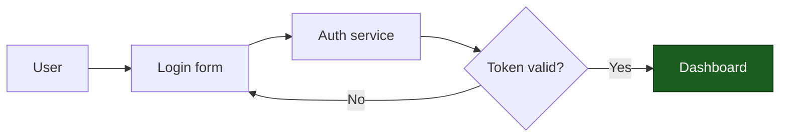

# Draw Diagram

Produce a diagram that *argues* a structure clearly and renders on the first try.

A diagram should make a relationship obvious at a glance. Validity is the floor,
not the goal: the win is choosing the right type, keeping it readable, and not
shipping syntax that silently fails to render.

## When NOT to use this skill

- Plotting quantitative data from a dataset — use a data-analysis/plotting tool.
- Raster/image generation or ASCII art — this skill only emits Mermaid syntax.
- Editing diagrams inside an external GUI tool.

## Engines

Mermaid is the default and only engine in v1. The workflow below (frame → pick
type → draft well → make render-safe → validate → output) is engine-agnostic;
mermaid-specific knowledge lives in `references/mermaid/`. To add another engine
later (D2, PlantUML, Graphviz), add a sibling `references/<engine>/` and branch
at Phase 2. Until then, generate mermaid.

## Phase 1 — Frame the request

The request — in `$ARGUMENTS` or the surrounding conversation — names what to
draw. Before drawing, pin down four things. Infer from context where you can; ask
only what blocks a good choice.

1. **Subject** — what system/process/idea is being depicted.
2. **Structure** — the *kind* of relationship, because it dictates the type:
   flow, interaction-over-time, lifecycle/state, entity relationships, hierarchy,
   chronology, schedule, comparison/positioning. This is the single most
   important decision.
3. **Audience & depth** — a quick sketch for a teammate vs. a precise spec.
   Controls node count and labeling detail.
4. **Render target** — where it will be viewed. This gates which syntax is safe:
   - **GitHub / GitLab / Obsidian / Notion** → conservative syntax only. These
     lag upstream (GitHub renders ~v11.4). Avoid v11.3+ `@{ shape: }` nodes, ELK
     layout, `look: handDrawn`, and beta diagram types (`architecture-beta`,
     `block-beta`, `packet-beta`, etc.). **Do not pin a theme via `%%{init}%%`**
     — it overrides GitHub's dark-mode contrast.
   - **mermaid.live / Mermaid Chart / mmdc / docs site you control** → latest
     features are fair game.

   If the target is unknown, **default to conservative syntax** — a diagram that
   renders everywhere beats one that breaks on GitHub.

## Phase 2 — Pick the diagram type

Match the structure from Phase 1 to a type. Common cases:

| You are showing… | Type | mermaid keyword |
|---|---|---|
| Process, decision flow, pipeline, "how it works" | Flowchart | `flowchart` |
| Messages/calls between actors over time | Sequence | `sequenceDiagram` |
| Lifecycle, finite states & transitions | State | `stateDiagram-v2` |
| Data model — tables/entities & relationships | Entity-relationship | `erDiagram` |
| Classes, interfaces, OOP structure | Class | `classDiagram` |
| Hierarchy, tree of ideas, brainstorm | Mindmap | `mindmap` |
| Chronological events / history / roadmap | Timeline | `timeline` |
| Schedule — tasks with dates & dependencies | Gantt | `gantt` |
| 2×2 prioritization / positioning | Quadrant | `quadrantChart` |
| Branch & release history | Git graph | `gitGraph` |
| Software architecture at C4 abstraction levels | C4 | `C4Context` (etc.) |
| Flow volumes/quantities between nodes | Sankey | `sankey-beta` |

For the full catalog (incl. `journey`, `xychart-beta`, `block-beta`,
`architecture-beta`, `pie`, `requirementDiagram`), the canonical minimal
template for each type, its "use when", and per-type quirks, read
**`{baseDir}/references/mermaid/diagram-types.md`** — load only the entry for the
type you chose (progressive disclosure keeps context lean).

When two types could work, prefer the one whose *default layout* matches the
story: sequence for ordered interaction, flowchart for branching logic, state
for "what can happen next".

## Phase 3 — Draft it well

Readability rules that separate a good diagram from a valid one. Apply all of
these; see `{baseDir}/references/design-principles.md` for the reasoning and
examples.

- **Argue, don't display.** Test it: if you stripped every label, would the
  *shape alone* still communicate the relationship? If not, restructure.
- **Right direction.** `LR` for wide/parallel/dependency graphs and pipelines;
  `TD`/`TB` for sequential decision flows. Screens are wider than tall — `LR`
  often fits docs better.
- **Descriptive IDs + separate labels.** `authService["Auth Service"]`, never a
  bare `A`. The ID documents the edge list; the label reads in the picture.
- **Group with subgraphs.** Cluster by subsystem / boundary / phase to kill
  edge spaghetti.
- **Cap complexity.** Aim for ≤ ~15 nodes. Past that, split into multiple
  focused diagrams rather than one unreadable wall.
- **Style with meaning, sparingly.** Use `classDef` for semantic roles
  (success / error / external / primary), 2–3 colors max. No rainbow. Set
  `fill`, `stroke`, and `color` together so text stays legible.
- **Label edges** when the relationship isn't obvious; keep labels short.
- **Accessibility.** Add `accTitle`/`accDescr`, and always include a one-line
  prose description outside the code block — screen readers get a disconnected
  node list, not the edges.

## Phase 4 — Make it render-safe

This is where most generated diagrams fail. Apply the defensive ruleset; the
full reference with failing-vs-fixed pairs is
**`{baseDir}/references/mermaid/syntax-safety.md`** — read it whenever you use a
label with special characters or a less common type.

The high-frequency rules:

- **Never use a reserved word as a bare node ID:** `end`, `graph`, `subgraph`,
  `style`, `class`, `classDef`, `click`, `direction`, `linkStyle`. (`end` is the
  classic foot-gun.) Uppercase it or give it a safe ID with a quoted label:
  `end_node["End"]`.
- **Don't start an ID with `o` or `x`** (e.g. `ox-->b`) — the parser reads it as
  an edge marker. Capitalize or prefix it.
- **Quote any label containing** `()[]{}<>:;&"#` or spaces-with-punctuation:
  `n1["Check status (retry?)"]`.
- **Escape with HTML entities, not backslashes:** `#quot;` `#35;` (#) `#amp;`
  `#lt;` `#gt;`. Line breaks are `<br/>`, never a literal newline or `\n`.
- **Keep IDs `[A-Za-z0-9_]`** — no dots, slashes, hyphens, or spaces. Put the
  real text in the quoted label.
- **Per-type quirks:** class generics are `~T~` not `<T>`; gantt task/section
  names can't contain `:`; mindmap has no quoting (plain words only). See the
  reference for the rest.

## Phase 5 — Validate

Confirm the diagram parses before presenting it.

1. Write the diagram body to a temp `.mmd` file.
2. Run the validator (it renders with `mmdc`, the authoritative parser):

   ```bash
   {baseDir}/scripts/validate.sh /tmp/diagram.mmd
   ```

   - Exit `0` → it parses. Proceed.
   - Exit `1` → read the stderr parse error, fix the *specific* problem
     (usually a Phase 4 rule), and re-run. Do not present an unparsed diagram.
   - Exit `2` (`mmdc` not installed) → the script no-ops gracefully. Fall back to
     a careful manual pass over the Phase 4 checklist; tell the user validation
     was skipped and how to enable it (`npm i -g @mermaid-js/mermaid-cli`).

3. To also eyeball it, render a PNG (`{baseDir}/scripts/validate.sh --png out.png in.mmd`)
   and view it — PNG, not SVG, is compact enough to interpret.

## Phase 6 — Output

- Default: present the diagram inline as a fenced ```mermaid block, followed by a
  one-line prose description of what it shows (accessibility + skimmability).
- Write a file only when the user asks or when it belongs in a doc. Use a
  `.md`/`.mmd` extension and tell the user the path.
- If you made a non-obvious modeling choice (picked type X over Y, split into two
  diagrams, dropped detail to stay readable), say so in one sentence.

## Worked example

Request: "diagram the login flow with a token check."

````

````

*Login flow: credentials go to the auth service; a valid token lands on the
dashboard, an invalid one returns to the form.*

## Hard prohibitions

Each guardrail pairs the rule with the reason, so the constraint can be applied
with judgment rather than followed blindly.

- **Validate before presenting.** Always run the diagram through
  `{baseDir}/scripts/validate.sh` (or, when `mmdc` is absent, pass it manually
  through the Phase 4 rules) first — unvalidated mermaid fails the parser
  silently, and a diagram that doesn't render is worse than no diagram.
- **Stay conservative on unknown/lagging targets.** Don't use v11.3+ `@{ }`
  shapes, beta diagram types, ELK layout, or `handDrawn` when the target is
  GitHub or unspecified, because those renderers lag upstream and will drop the
  feature or show raw text.
- **Keep IDs and labels parser-safe.** Don't use a bare reserved word as a node
  ID or leave special characters unquoted in a label — both are the top causes of
  silent parse failure (see `{baseDir}/references/mermaid/syntax-safety.md`).
- **Split instead of padding.** Don't push a diagram past ~15 nodes for
  impressiveness; comprehension and legibility collapse, so break it into a
  context diagram plus drill-downs.
- **Don't invent syntax.** Use only real diagram-type keywords and node shapes;
  guessed syntax won't render. When unsure, check
  `{baseDir}/references/mermaid/diagram-types.md`.

